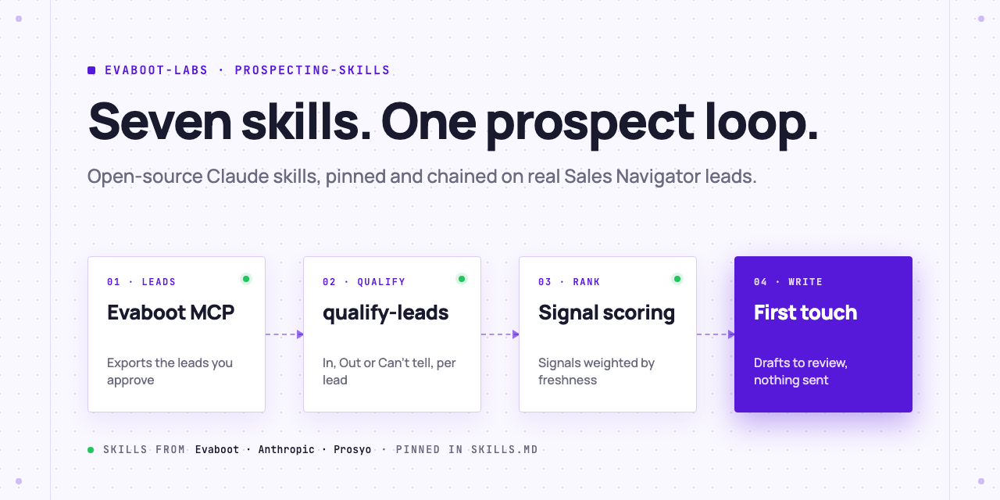
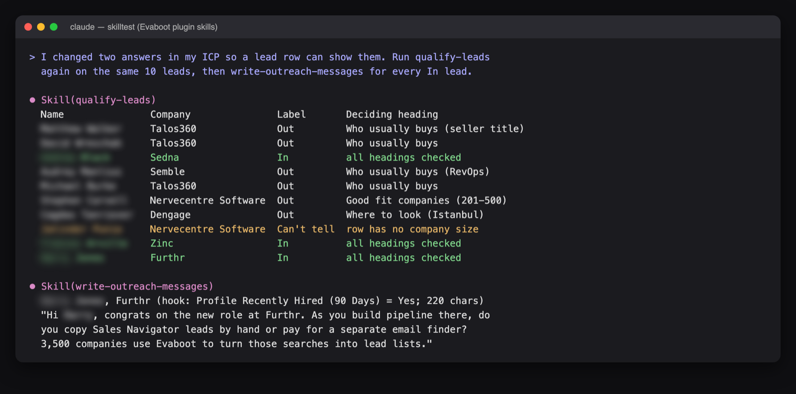
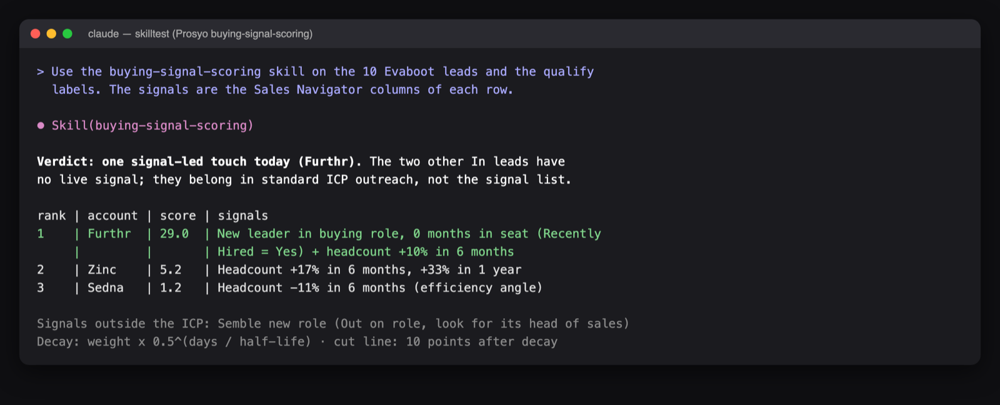
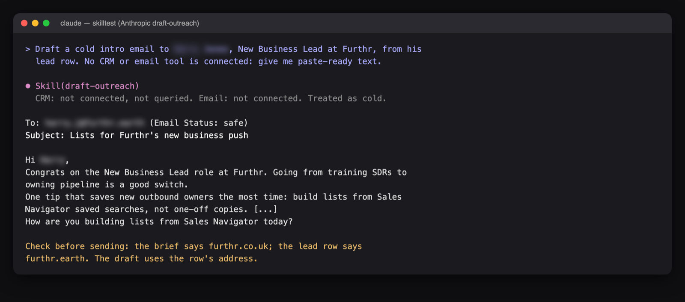

<picture>
  <source media="(prefers-color-scheme: dark)" srcset=".github/assets/banner-dark.png">
  
</picture>

# Prospecting skills

Six open-source Claude skills for B2B prospecting from Evaboot, Anthropic and Prosyo, pinned to the commits we tested, and one skill that runs them as a loop on real Sales Navigator leads. Each step writes a file you can read. Nothing is sent.

[](AGENTS.md)
[](https://evaboot.com/mcp)
[](LICENSE)

## Set it up in one prompt

Paste this into Claude Code:

```text
Clone https://github.com/evaboot-labs/prospecting-skills, read AGENTS.md and follow the skill. Run the prospecting skills on 10 leads that match my ICP.
```

<details>
<summary>Or install the skills</summary>

Claude Code:

```text
/plugin marketplace add evaboot-labs/prospecting-skills
/plugin install prospecting-skills@evaboot-labs-prospecting-skills
```

Codex, Cursor and other agents:

```bash
npx skills add evaboot-labs/prospecting-skills
```

</details>

## How it works

**1. Evaboot exports, `qualify-leads` judges.** One label per lead against your ICP file, with the heading that decided it.



**2. `buying-signal-scoring` ranks the leads that fit.** Sales Navigator signals, weighted by strength and freshness, with a play per lead.



**3. `draft-outreach` writes the email, you review.** Paste-ready text when no email tool is connected, with the facts it checked.



## What you need

- An [Evaboot account](https://dash.evaboot.com/accounts/signup/?last_click_origin=prospecting-skills-repo) and a Sales Navigator seat.
- Claude Code, Codex or Cursor, or n8n with the workflow in `n8n/`.
- Cost: the skills are free. 1 Evaboot credit per exported lead, plus your Claude usage. Rerunning a step on an export you have costs no credits.

## Go further

| Page | For |
|---|---|
| [SKILLS.md](SKILLS.md) | Each skill, its publisher, license and pinned commit |
| [docs/connect-your-agent.md](docs/connect-your-agent.md) | The Evaboot MCP, by hand, for each agent |
| [docs/n8n.md](docs/n8n.md) | Three of the skills in n8n |
| [THIRD-PARTY-NOTICES.md](THIRD-PARTY-NOTICES.md) | The licenses of the copied skills |

---

Agents: start at [AGENTS.md](AGENTS.md) · Built by [Evaboot](https://evaboot.com) · More workflows at [github.com/evaboot-labs](https://github.com/evaboot-labs) · [MIT license](LICENSE), except the copied skills: [THIRD-PARTY-NOTICES.md](THIRD-PARTY-NOTICES.md)
